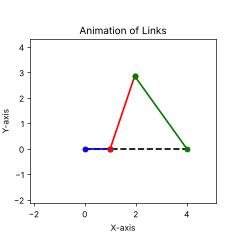

# Four-Bar Mechanism – Kinematic and Dynamic Analysis

Python script for the kinematic analysis and a simplified force analysis of a four-bar linkage, developed as coursework for the Dynamics of Machinery course at Shiraz University.

## What it does

- Solves the position, velocity and acceleration loop-closure equations for the coupler and rocker over one full crank revolution (720 steps, `scipy.optimize.fsolve`)
- Uses each solution as the initial guess for the next crank angle (continuation), so the solver stays on the same assembly branch
- Estimates the inertia forces on each link from the computed kinematics (simplified model)
- Plots angles, angular velocities, angular accelerations and forces against the crank angle
- Animates the mechanism over one crank revolution
- Checks the Grashof condition and solver convergence, and warns if the crank cannot make a full revolution

## How to run

    python four_bar_mechanism.py

Enter the link lengths, crank speed and link masses when prompted. Example of a valid crank-rocker: ground 4, crank 1, coupler 3, rocker 3.5, ω₂ = 2.5 rad/s.

## Tools

Python, NumPy, SciPy (fsolve), Matplotlib

## Update (Nov 2026)

Revisited this coursework and fixed several bugs: velocity and acceleration equations, solver initial guess, plot units and animation geometry. Results were validated against finite differences and the analytical rocker extremes. Added a Grashof check and solver convergence warnings.

## Background

Originally required coursework, submitted and graded as part of the Dynamics of Machinery course.
